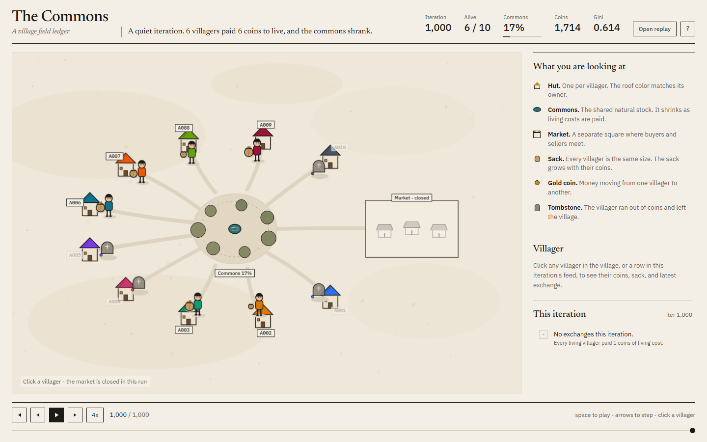

# Exchange Dynamics Simulation



*Default configuration, 1,000 iterations. Every villager has a hut and a money
sack; the commons shrinks as resources are consumed. Open `simulation.html` to
replay the whole run.*

An experimental agent-based simulation of resource sharing and inequality.
Agents have different generosity and acceptance tendencies. During each
iteration, living agents may transfer a variable amount of resources to another
living agent, remember previous givers, and pay a fixed cost of living.
An agent that reaches the configured resource floor is dead and no longer
participates in transfers.

## Status

This is a small research-style simulation project. It is intended to make the
rules and measurements easy to inspect, not to model a real economy or make
economic predictions.

Supported Python versions: 3.11 through 3.14.

## Model

Each agent has:

- a money balance (`resources`);
- a resource floor below which the agent is dead;
- a generosity score, which controls the chance of giving;
- an acceptance score, which controls the chance of receiving;
- short-term memory of agents that previously transferred resources, plus
  optional private trust beliefs;
- an optional goods inventory; and
- a fixed risk tolerance.

The optional layers add a goods market, trust and reputation, reciprocity, and
environmental shocks. `MODEL.md` documents the combined rules and conservation
ledger.

Affordability is derived from the agent's resource balance. Agents below the
configured resource range become less likely to give, while acceptance is
weighted in the opposite direction. Transfer amounts are sampled from the
configured range and capped by the giving floor and receiving ceiling. A
transfer is made only when both agents are alive. After transfers, every
living agent pays the configured cost of living; reaching the resource floor
does not create a resource top-up.

The simulation records mean, median, standard deviation, total resources, and
the Gini coefficient after each iteration. Successful gifts, repayments, and
market trades also go into `transfer_log` and `trade_log`, which the visualizer
replays. The source of truth is a list of `Agent` objects; Pandas is used only
to expose the current state for analysis.

## Market (optional)

`config.yaml` has a `MARKET` section that is disabled by default. When
`MARKET.ENABLED` is true, living agents also produce and consume one good:

- each agent produces `PRODUCTION_RANGE` goods per iteration;
- each agent needs `CONSUMPTION_RANGE` goods per iteration;
- agents consume their own goods first and buy shortfalls from other agents'
  surplus at the fixed `PRICE`;
- unsold goods stay in inventory, and unmet demand is recorded.

Transfers and market trades only move money between agents. Production creates
goods, consumption destroys them, and the living cost remains an explicit money
sink. `MODEL.md` documents the full ledger, and `tests/test_conservation.py`
plus `tests/test_market.py` enforce it.

## Altruism and reciprocity (optional)

Direct transfers are the altruism layer; market trades are kept separate. Set
`SOCIAL.RECIPROCITY_ENABLED: true` to schedule a possible repayment after each
gift. `REPAY_PROBABILITY`, `REPAY_DELAY`, and `REPAY_FRACTION` control the
attempt. `repayment_log` records who repaid whom and how quickly, while metrics
report `altruism_volume`, `reciprocity_rate`, `outstanding_debt`, and
`mean_repayment_delay`. `tests/test_social.py` covers the rules.

## Environmental shocks (optional)

Set `SHOCKS.ENABLED: true` and list events in `SHOCKS.SCHEDULE` to apply
`scarcity` (reduced production) or `information` (noisy reputation) shocks for
a fixed `duration`. Living agents adapt their risk tolerance when demand is
unmet. Metrics include `shock_active`, `production_modifier`,
`reputation_noise`, `mean_risk_tolerance`, and `alive`; `recovery_time()`
reports how long unmet demand took to return to its pre-shock level.
`tests/test_shocks.py` covers the rules.

## Trust and reputation (optional)

Set `TRUST.ENABLED: true` to add private beliefs and public reputation. Every
agent starts at `INITIAL_BELIEF`. After a transfer, the receiver updates its
belief about the giver and a shared public reputation observation, with
configurable `LEARNING_RATE`, `DECAY`, `NOISE`, `DELAY`, `BIAS`, and
`PUBLIC_WEIGHT`. The simulation reports `mean_trust`, `mean_reputation`,
`reputation_error`, and `reputation_brier`.

Set `TRUST.DECISION_WEIGHT` above 0 to use those beliefs in giving and
accepting decisions. Expected payoff is `belief * RETURN_MULTIPLIER - 1`, turned
into a probability with each agent's fixed `RISK_TOLERANCE`, then blended with
the legacy score. Trusted agents are also selected as receivers more often.
`decision_log` records each attempt; `tests/test_trust.py` and
`tests/test_decisions.py` cover the update and decision rules.

## Experiments

`experiments.py` runs each seed and parameter combination, then writes raw runs
and a summary with 95% confidence intervals:

```bash
python experiments.py --iterations 500 --seeds 1 2 3 \
  --sweep SIMULATION.AGENTS=5,10 \
  --sweep MARKET.ENABLED=true \
  --output results/runs.csv
```

Sweep values are parsed as JSON when possible, so booleans, numbers, and lists
work (`SHOCKS.SCHEDULE='[{"iteration": 100, "type": "scarcity", "magnitude": 0.5}]'`).
The command writes `results/runs.csv`, `results/runs_summary.csv`, and
`results/runs_summary.json`. Use `--config` to start from a custom YAML file and
`--metrics` to choose which final metrics to aggregate.

## Replay export

The simulation can write a versioned, headless replay log instead of only an
HTML page. The log is the stable boundary between the model and any renderer:

```bash
python main.py --replay replay.json.gz --iterations 500
# or run the exporter directly
python replay.py --output replay.json.gz --iterations 500
```

`replay.py` writes compact JSON (gzip when the path ends in `.gz`) and validates
it on both write and load. A replay contains:

- `schema_version` and `meta`: the format version, actual iteration count, seed,
  config, and enabled feature flags;
- `agents`: stable ids, labels, colors, and initial traits;
- `ticks`: one entry per iteration, with per-agent resources, goods, alive
  status, risk tolerance, reputation, and summary metrics such as Gini and the
  commons stock ratio;
- `events`: typed `gift`, `repayment`, `trade`, `death`, and `shock` records,
  each with a tick, phase, sequence number, and stable id.

Deaths are recorded explicitly with their cause (`gift`, `repayment`, `market`,
or `living_cost`) instead of being inferred from a resource crossing. The
`living_cost_paid` metric records the only money sink, so total resources can be
reconciled from the replay alone.

## Quick start

```bash
python -m venv .venv
# Windows
.venv\Scripts\activate
# macOS/Linux: source .venv/bin/activate

python -m pip install -r requirements.txt
python main.py --iterations 500
python visualize.py --iterations 500
python -m pytest -q
```

Both `main.py` and `visualize.py` support `--config <path>` to load a custom YAML
configuration file and `--iterations <n>` to override the run length.

`visualize.py` creates a self-contained `simulation.html` village view that
replays the recorded run. Open it in a browser; the replay starts automatically
(press **space** to pause). Every agent has a hut around the green. All
villagers are the same size; the sack beside each one grows and shrinks with
their coin balance, so wealth is visible without changing the body size. A gold
coin is drawn whenever money changes hands: gifts and repayments happen at the
receiver's hut, while market trades happen in the separate market square. The
commons pond shows the village's remaining total resources, so it visibly
shrinks as living costs consume them. Click a hut's owner or a feed row to
inspect a villager, and drag the timeline to scrub. When everyone dies, the
timeline trims at extinction.

The world is a presentation layer over the recorded events, not a change to
who can interact: it replays the existing model and leaves conservation
untouched. The view works with the optional layers: enable `MARKET`, `TRUST`,
`SOCIAL`, and `SHOCKS` in the configuration and their effects appear in the
village, inspector, and event feed. Pass `--plotly` to `visualize.py` to write
the original Plotly line chart instead.

The random seed and model parameters are defined in `config.yaml` and loaded
through `utils.load_config`. For interactive use, construct
`ResourceSimulation` with a copied and edited configuration, call `run()`, and
inspect `metrics_history` or the returned DataFrame.

## Project structure

- `config.yaml` - default simulation parameters.
- `main.py` - agents, simulation lifecycle, affordability, market, and metrics.
- `utils/` - shared helpers, including YAML configuration loading.
- `tests/` - unit and behavior tests for the model.
- `visualize.py` - animated world view plus the legacy Plotly chart.
- `replay.py` - versioned JSON replay export and validation.
- `templates/world.html` - self-contained HTML/CSS/Canvas replay renderer.
- `experiments.py` - seed and parameter sweep runner with confidence intervals.
- `TRUST_SOCIETY_SCOPE.md` - research scope and roadmap.
- `TODO.md` - implementation tasks derived from the roadmap.
- `MODEL.md` - units, conservation ledger, and market rules.
- `requirements.txt` - runtime and test dependencies.

## Limitations

The model has no wages, rent, births, or spatial network. The market uses a
single good at a fixed price, shocks follow a fixed schedule, and trust updates
are simple heuristics rather than estimated beliefs. Its results depend on the
chosen rules and random seed; treat it as an educational simulation and a base
for further experiments.
