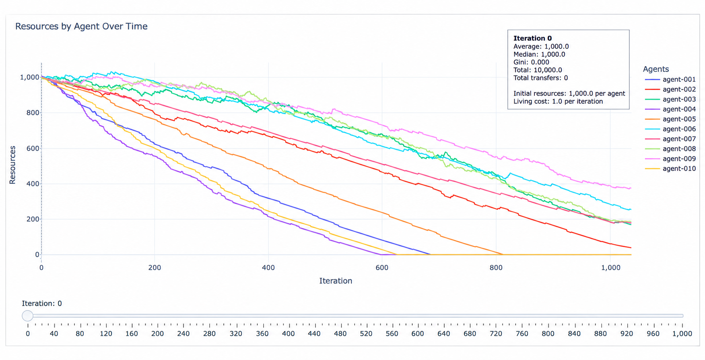

# Exchange Dynamics Simulation



*Default configuration, 1,000 iterations. The interactive chart starts at iteration 0.*

An experimental agent-based simulation of resource sharing and inequality.
Agents have different generosity and acceptance tendencies. During each
iteration, living agents may transfer a variable amount of resources to another
living agent, remember previous givers, and pay a fixed cost of living.
An agent that reaches the configured resource floor is dead and no longer
participates in transfers.

## Status

This is a small research-style simulation project. It is intended to make the
rules and measurements easy to inspect, not to model a real economy or make
economic predictions.

Supported Python versions: 3.11 through 3.14.

## Model

Each agent has:

- a resource balance;
- a resource floor below which the agent is dead;
- a generosity score, which controls the chance of giving;
- an acceptance score, which controls the chance of receiving; and
- short-term memory of agents that previously transferred resources to them.

Affordability is derived from the agent's resource balance. Agents below the
configured resource range become less likely to give, while acceptance is
weighted in the opposite direction. Transfer amounts are sampled from the
configured range and capped by the giving floor and receiving ceiling. A
transfer is made only when both agents are alive. After transfers, every
living agent pays the configured cost of living; reaching the resource floor
does not create a resource top-up.

The simulation records mean, median, standard deviation, total resources, and
the Gini coefficient after each iteration. The source of truth is a list of
`Agent` objects; Pandas is used only to expose the current state for analysis.

## Market (optional)

`config.yaml` has a `MARKET` section that is disabled by default. When
`MARKET.ENABLED` is true, living agents also produce and consume one good:

- each agent produces `PRODUCTION_RANGE` goods per iteration;
- each agent needs `CONSUMPTION_RANGE` goods per iteration;
- agents consume their own goods first and buy shortfalls from other agents'
  surplus at the fixed `PRICE`;
- unsold goods stay in inventory, and unmet demand is recorded.

Transfers and market trades only move money between agents. Production creates
goods, consumption destroys them, and the living cost remains an explicit money
sink. `MODEL.md` documents the full ledger, and `tests/test_conservation.py`
plus `tests/test_market.py` enforce it.

## Altruism and reciprocity (optional)

Direct transfers are the altruism layer; market trades are kept separate. Set
`SOCIAL.RECIPROCITY_ENABLED: true` to schedule a possible repayment after each
gift. `REPAY_PROBABILITY`, `REPAY_DELAY`, and `REPAY_FRACTION` control the
attempt. `repayment_log` records who repaid whom and how quickly, while metrics
report `altruism_volume`, `reciprocity_rate`, `outstanding_debt`, and
`mean_repayment_delay`. `tests/test_social.py` covers the rules.

## Environmental shocks (optional)

Set `SHOCKS.ENABLED: true` and list events in `SHOCKS.SCHEDULE` to apply
`scarcity` (reduced production) or `information` (noisy reputation) shocks for
a fixed `duration`. Living agents adapt their risk tolerance when demand is
unmet. Metrics include `shock_active`, `production_modifier`,
`reputation_noise`, `mean_risk_tolerance`, and `alive`; `recovery_time()`
reports how long unmet demand took to return to its pre-shock level.
`tests/test_shocks.py` covers the rules.

## Trust and reputation (optional)

Set `TRUST.ENABLED: true` to add private beliefs and public reputation. Every
agent starts at `INITIAL_BELIEF`. After a transfer, the receiver updates its
belief about the giver and a shared public reputation observation, with
configurable `LEARNING_RATE`, `DECAY`, `NOISE`, `DELAY`, `BIAS`, and
`PUBLIC_WEIGHT`. The simulation reports `mean_trust`, `mean_reputation`,
`reputation_error`, and `reputation_brier`.

Set `TRUST.DECISION_WEIGHT` above 0 to use those beliefs in giving and
accepting decisions. Expected payoff is `belief * RETURN_MULTIPLIER - 1`, turned
into a probability with each agent's fixed `RISK_TOLERANCE`, then blended with
the legacy score. Trusted agents are also selected as receivers more often.
`decision_log` records each attempt; `tests/test_trust.py` and
`tests/test_decisions.py` cover the update and decision rules.

## Quick start

```bash
python -m venv .venv
# Windows
.venv\Scripts\activate
# macOS/Linux: source .venv/bin/activate

python -m pip install -r requirements.txt
python main.py --iterations 500
python visualize.py --iterations 500
python -m pytest -q
```

Both `main.py` and `visualize.py` support `--config <path>` to load a custom YAML
configuration file and `--iterations <n>` to override the run length.

`visualize.py` creates a self-contained `simulation.html` Plotly chart. Open it
in a browser to inspect each agent's resource balance over time and move the
iteration slider. The summary card in the chart updates with the selected
iteration.

The random seed and model parameters are defined in `config.yaml` and loaded
through `utils.load_config`. For interactive use, construct
`ResourceSimulation` with a copied and edited configuration, call `run()`, and
inspect `metrics_history` or the returned DataFrame.

## Project structure

- `config.yaml` - default simulation parameters.
- `main.py` - agents, simulation lifecycle, affordability, market, and metrics.
- `utils/` - shared helpers, including YAML configuration loading.
- `tests/` - unit and behavior tests for the model.
- `visualize.py` - interactive Plotly visualization.
- `TRUST_SOCIETY_SCOPE.md` - research scope and roadmap.
- `TODO.md` - implementation tasks derived from the roadmap.
- `MODEL.md` - units, conservation ledger, and market rules.
- `requirements.txt` - runtime and test dependencies.

## Limitations

The model has no production data, wages, rent, births, deaths, or spatial
network. Its results depend on the chosen rules and random seed. It should be
treated as an educational simulation and a base for further experiments.
