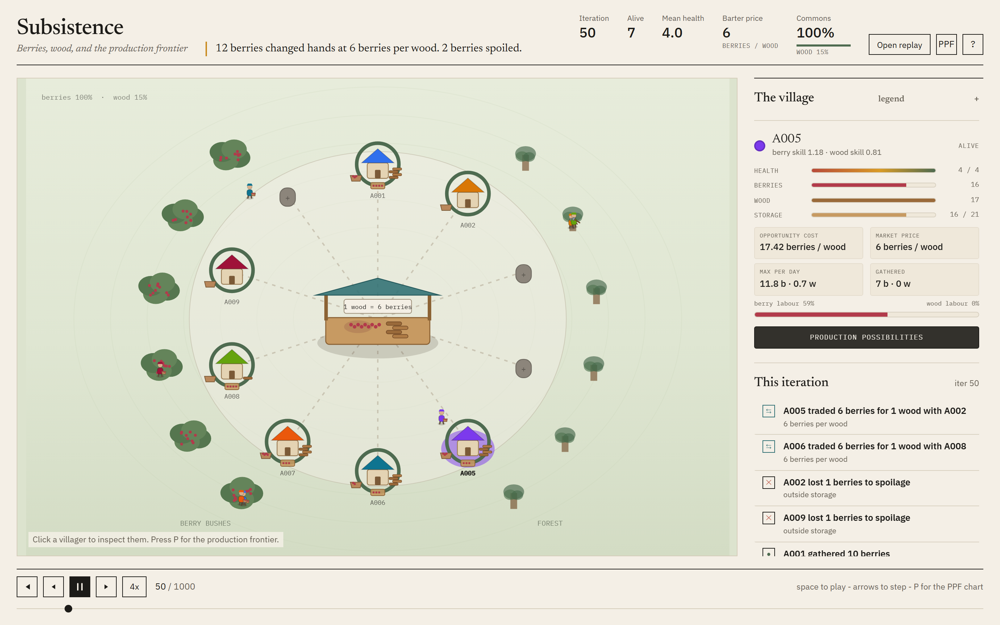
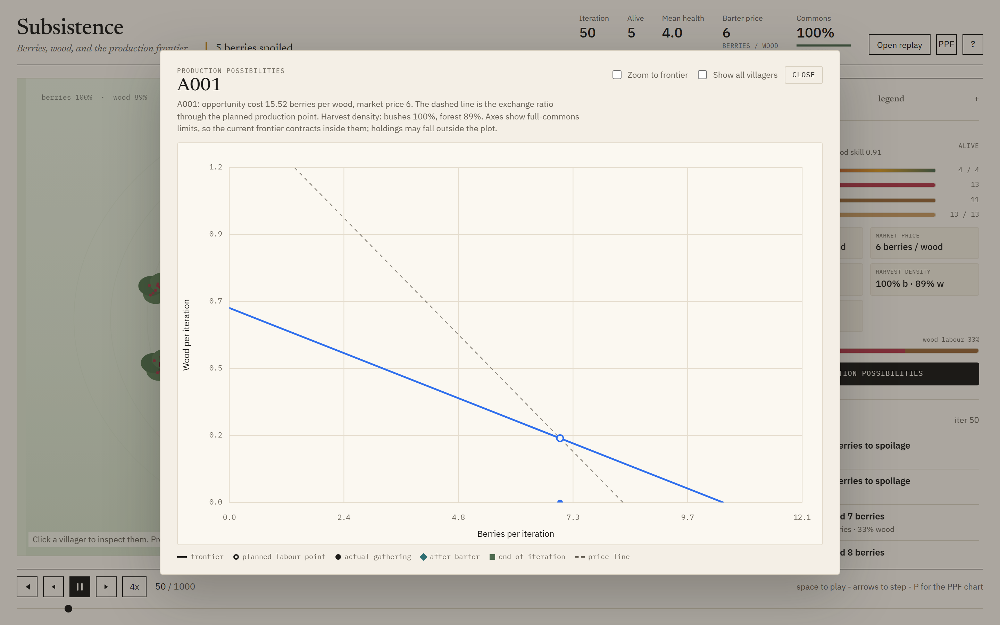
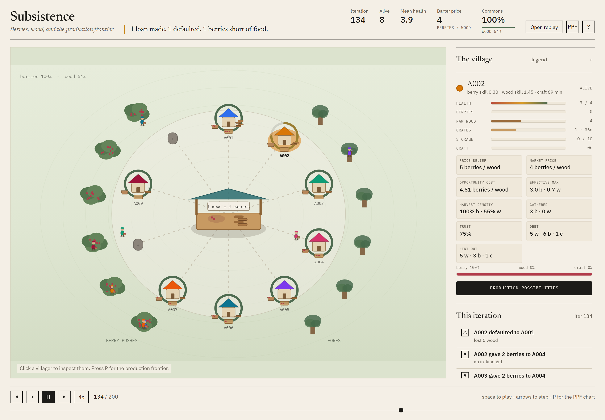

# Exchange Dynamics Simulation



*Default subsistence configuration at iteration 50. Five villagers remain, the
berry commons is full, and the forest is at about 69%. The selected villager has
two crates with four stored berries, nine raw wood kept as a replacement
reserve, a price belief of four while the market clears at three, and an
effective wood frontier contracted by harvest density. The inspector shows the
small post-meal reserve, the spare wood, the belief, and the density state used
by the PPF and search animation.*

An experimental agent-based laboratory for exchange, survival, and inequality.
The repository now holds **two worlds** that share a small set of simulation
utilities:

| World | Directory | What it models |
| --- | --- | --- |
| **Subsistence** | `worlds/subsistence/` | Goods only. Villagers start with ten berries and one crate, gather perishable berries and durable wood from a shared commons, eat, store food in perishable crates, barter, and optionally lend wood, berries, or crate capacity. No money. |
| **Money** | `worlds/money/` | The original model: money transfers, gifts, a goods market, reciprocity, trust, and environmental shocks. |

The subsistence world is the new primary world and has its own experiment
runner. The money world is kept working for the earlier research questions and
for comparison.

## Quick start

```bash
python -m venv .venv
# Windows: .venv\Scripts\activate
# macOS/Linux: source .venv/bin/activate
python -m pip install -r requirements.txt

# Run the subsistence world and write a replay plus a standalone viewer.
python -m worlds.subsistence --iterations 500 \
  --replay replay-subsistence.json.gz \
  --html simulation-subsistence.html

# The original money world.
python main.py --iterations 500

python -m pytest -q
```

Open `simulation-subsistence.html` in a browser. It is self-contained and
starts playing immediately. Press **space** to pause, use the arrows to step,
drag the timeline to scrub, and click a villager to inspect them.

## The subsistence model in one page

- **Everyone starts with a starter kit.** Ten berries, no raw wood, and one
  finished crate. There is no money.
- **Health is a four-day food buffer.** A full-health villager survives four
  days without food. A day with a full ration restores one point; a day short of
  food drains one. The default daily ration is six berries.
- **Berries are food and spoil.** Berries not eaten and not inside storage
  spoil at the end of the iteration. Berries and wood are always whole units.
- **Food is kept as a small reserve, not a full larder.** A villager aims for
  about two days of post-meal berries, capped by crate space, and refills only
  when the reserve runs low. The rest of the day goes to wood or carpentry, and
  a villager with crates keeps one spare crate's worth of raw wood for
  replacements.
- **Crates are capital.** Eight raw wood plus about a day of skilled carpentry
  make one crate, which stores ten berries. Raw wood is only material, not
  storage. Crates wear out faster when they are full.
- **The day is finite.** Each villager has a fixed number of working minutes.
  Picking berries is quick; chopping wood is much slower. Woodworkers choose
  between berries, raw wood, and carpentry, and unfinished work carries over.
- **Sparse commons adds search time.** Gathering and chopping costs rise as the
  berry bushes and forest thin, with a safe density floor. The production
  possibilities frontier contracts with the current commons density, and
  villagers visibly move between several sparse sites.
- **Skills differ.** Each villager draws one shared specialisation latent `z`.
  Berry skill rises with `z` and wood skill falls with it, so strong pickers are
  weak choppers and strong choppers are weak pickers. Woodworkers also have a
  comparative advantage in carpentry.
- **Prices are discovered.** Every villager carries an integer price belief in
  berries per wood. Bilateral bargains clear at the midpoint of seller and
  buyer reservations, and realized prices plus market gossip update beliefs with
  a one-tick lag. There is no global price setter.
- **Choices are sampled.** Each day a villager draws a small taste shock on the
  berry-versus-wood comparison and occasionally explores the other activity, so
  behaviour varies around the rational benchmark instead of repeating exactly.
- **Credit is optional.** A loan moves wood, berries, or crate capacity now and
  returns the same good later. Reciprocal mode is zero-interest and gated by
  trust or collateral; market mode prices default risk into a real goods
  interest rate. Loans, repayments, and defaults run through the same goods
  ledger as gifts and trade.
- **Gifts and reciprocity share one obligation book.** A plain gift is one-way.
  With reciprocity on it also creates a soft zero-interest obligation that the
  receiver repays when it has surplus berries. That is the low-commitment end of
  the credit spectrum.
- **Shocks are optional.** A drought temporarily cuts berry and wood
  regeneration, so the same labour yields less until it passes.
- **The commons is shared and depletable.** Berry bushes and forest regenerate
  each iteration. Berry bushes recover quickly; wood regrows much more slowly.

The detailed rules, formulas, iteration order, and conservation ledger are in
[`worlds/subsistence/MODEL.md`](worlds/subsistence/MODEL.md).

## Feature flags

Every experimental layer is a flag in `worlds/subsistence/config.yaml`:

```yaml
FEATURES:
  GIFTING: false       # direct in-kind gifts, off by default
  TRADE: true          # barter at a berries-per-wood ratio
  CREDIT: false        # reciprocal or risk-priced loans
  STORAGE: true        # finished crates provide storage capacity
  SPOILAGE: true       # unprotected berries spoil
  TRUST: false         # public credit reputation
  RECIPROCITY: false   # gifts become soft obligations
  SHOCKS: false        # temporary commons droughts
```

Set a flag to `false` to isolate a mechanism. For example, turning `SPOILAGE`
off removes the reason to store berries; turning `TRADE` off creates a
self-sufficiency experiment; turning `GIFTING` on adds need-based berry gifts
from a shared utility. The harvesting, health, and commons rules stay the same.

The money world keeps its own flags (`GIFTING.ENABLED`, `MARKET.ENABLED`,
`SOCIAL.RECIPROCITY_ENABLED`, `TRUST.ENABLED`, `SHOCKS.ENABLED`) in
`worlds/money/config.yaml`. Gifting is off there by default too.

## The production possibilities chart

Press **P** or the **PPF** button to expand the chart. It shows the selected
villager's density-adjusted frontier, their planned labour point, what they
actually gathered, and their holdings after barter. The dashed line is the
current exchange ratio. **Zoom to frontier** scales the axes to the effective
frontier so the trade-off is readable; **Show all villagers** overlays every
living villager's frontier. In the normal view the axes stay at full-commons
limits, so a contraction from sparse bushes or trees is visible.



The chart updates with the timeline and the selected villager, so it can be
used to compare a berry specialist with a wood specialist at the same
iteration.

## Visual replay

The subsistence viewer is in `worlds/subsistence/viewer/`. It is a standalone
replay client; it does not import the model. You can either open the generated
`simulation-subsistence.html` or serve the repository root and open:

```text
http://localhost:8000/worlds/subsistence/viewer/?replay=/replay-subsistence.json.gz
```

The viewer shows health rings, berry baskets, raw wood, perishable crates and
their durability, shared berry bushes and forest, villagers walking out to pick,
chop, or craft, bilateral barter tokens, price beliefs, credit flows, spoilage,
and deaths. The side panel explains the iconography and lists each iteration's
gather, craft, gift, trade, credit, shock, spoilage, and death events.

## Credit modes

Credit is opt-in. The two modes use the same loan book and goods ledger:

```yaml
FEATURES:
  CREDIT: true
CREDIT:
  MODE: reciprocal   # zero-interest, trust or crate collateral
```

```yaml
FEATURES:
  CREDIT: true
CREDIT:
  MODE: market       # default risk priced into a real goods interest rate
```

A loan can move wood, berries, or a whole crate. Crate lending is direct
capacity lending: the borrower gets storage now and returns a crate later. The
lent crate also serves as collateral, so crate-capacity loans carry no goods
interest in either mode. Defaults seize pledged crates and then the borrower's
stock of the loan good; the rest is a claim loss, not destroyed goods.



*A market-credit run. The selected wood specialist has defaulted on a wood
loan, owes five wood, six berries, and one crate-capacity, and has lent similar
amounts. Trust is 75%. The feed shows the default, gifts, and a new risk-priced
wood loan.*

To write only a replay:

```bash
python -m worlds.subsistence --iterations 1000 --replay replay-subsistence.json.gz
```

The replay is version 2 and carries the world type, feature flags, agent
skills, per-tick health and goods, pre/post-trade production points, and typed
`gather`, `gift`, `trade`, `spoil`, and `death` events. `worlds/subsistence/replay.py`
validates it on write and load.

## Experiments

The subsistence runner sweeps seeds and any dotted configuration key, including
feature flags:

```bash
python -m worlds.subsistence.experiments --iterations 300 --seeds 1 2 3 \
  --sweep FEATURES.GIFTING=true,false \
  --sweep FEATURES.STORAGE=true,false \
  --sweep STORAGE.WOOD_DECAY_CHANCE=0,0.02,0.05 \
  --sweep FEATURES.CREDIT=true \
  --sweep CREDIT.MODE=reciprocal,market \
  --output results/subsistence.csv
```

It writes raw runs plus a summary with 95% confidence intervals. Useful metrics
include `alive`, `mean_health`, `berries_spoiled`, `trade_berries`,
`barter_price`, `ppf_efficiency`, `specialisation`, `gini_berries`,
`gini_wood`, and `unmet_food`.

The original money-world experiment runner is still available as
`python experiments.py`.

## Project structure

```text
utils/                    shared tooling: config, metrics, replay I/O,
                          experiment sweeps, and social helpers
worlds/
  money/                  original money world, config, replay, and docs
  subsistence/            goods-only world, config, replay, viewer, and docs
    features/             composable trade, gift, trust, reciprocity, credit,
                          and shock layers
viewer/                   original money-world viewer
docs/                     README screenshots
tests/                    tests for both worlds and the shared utilities
main.py, replay.py, ...   compatibility entry points for the money world
MODEL.md                  index of the two model documents
```

The root `main.py`, `replay.py`, `experiments.py`, and `visualize.py` are thin
compatibility shims for the money world. New code should import from
`worlds.money` or `worlds.subsistence` directly.

## Model documents

- [`worlds/subsistence/MODEL.md`](worlds/subsistence/MODEL.md) — berries, wood,
  health, storage, spoilage, barter, credit, trust, reciprocity, shocks, PPF,
  and the conservation ledger.
- [`worlds/money/MODEL.md`](worlds/money/MODEL.md) — money, gifts, reciprocity,
  trust, the market, and shocks.
- [`MODEL.md`](MODEL.md) — a short index of both.

## Limitations

The subsistence world has two goods, a shared commons, and simple,
explainable labour, trade, and credit heuristics rather than a full optimisation
model. Credit and social layers are opt-in and off by default; their results
depend on the chosen rules and random seed, so treat each run as an experiment,
not a prediction.
