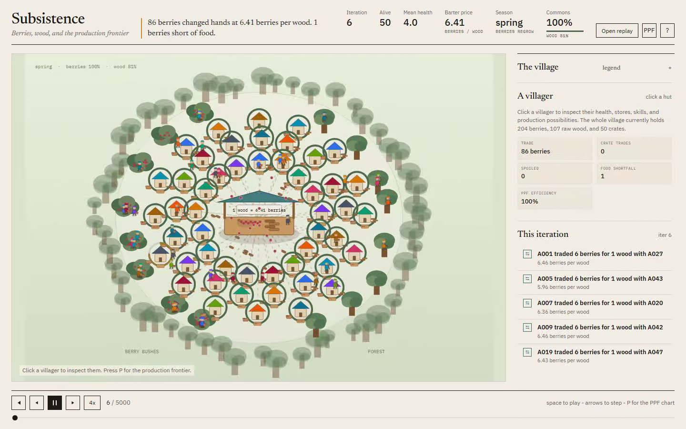

# What emerged in one subsistence year

[](subsistence-year.webm)

**Watch:** [`subsistence-year.webm`](subsistence-year.webm) — 60 seconds, spring →
summer → autumn → winter → spring, iterations 1–181.

This is a recorded run of 50 villagers over 5,000 iterations (seed 42, default
flags: trade, storage, and spoilage on; credit, gifts, trust, and shocks off;
45-iteration seasons; commons scaled to village size). The video covers the first
year, which is where the selection happens.

Reproduce it:

```bash
python -m worlds.subsistence --agents 50 --iterations 5000 \
  --replay replay-50.json.gz
node worlds/subsistence/viewer/capture.mjs --replay replay-50.json.gz \
  --out docs/subsistence-year.webm --from 1 --to 181 --seconds 60
```

## 1. The cold start is the filter, not winter

The popular story is that winter kills the specialists. The replay says
otherwise. Of 24 deaths in the whole run, **23 happen in the first year**, and
**19 of them in the first spring**. All 20 villagers with berry skill below 0.60
are dead by day 71, 19 of them by day 35. A043 (berry 0.47, wood 1.32) dies on
day 14; A048 (berry 0.54, wood 1.27) dies on day 23.

The mechanics are unforgiving:

- Health is a four-day buffer, and the daily ration is 6 berries.
- A berry skill of 0.47 caps gathering at 4.7 berries per day, so the villager
  can never eat its way out of the hole.
- It survives only by chopping roughly one wood per day and selling it for
  6–6.5 berries. That works while there is a buyer.
- Wood demand is thin: each berry specialist needs only a little wood for its
  own crate and reserve. Once the marginal buyers are stocked, the marginal
  wood seller has nothing to sell and starves.

The village then stabilises at **26 alive on day 181 and 26 on day 5000**. The
filter runs once, at the start, and the survivors are the ones whose skill mix
covers both a ration and a marketable surplus.

Only 3 of the 24 deaths happen in winter, in later years. Winter is a bottleneck,
not the selector — at least at these parameters.

## 2. Winter is real, but the commons is the granary

In winter berry regeneration is exactly zero; wood keeps coming in at 5 blocks a
day. The village survives because the commons holds the carry-over: at the end of
winter the berry stock is still ~14,000 (100% of the initial stock, 94% of
capacity), and the village eats out of it.

The price signal does move: wood costs about 9.5 berries in summer and 11.2 in
winter, as stored berries become the scarce side. Measured over the whole run,
the barter price settles near 9.6. Winter rewards whoever left stock standing;
it does not create a second mass die-off.

## 3. The crate liquidity trap

At iteration 4057 the village holds **51 crates across 26 survivors — 1.96 each —
and has traded zero crates that year.**

A crate costs 8 raw wood plus about a day of carpentry (76–145 minutes depending
on wood skill) and stores 10 berries. Two crates plus the 7–9 raw wood villagers
keep as replacement material saturate the design: more storage buys nothing,
because the food reserve target is two days and spoilage is the only pressure on
holding berries outside a crate.

Crates wear at 0.01 durability per day, and the use factor is 1.0, so the
replacement market is small and lumpy. Carpentry is therefore a **replacement
trade**, not a growth trade, and a carpenter cannot count on steady demand once
the initial storage build-out is done.

Knobs, if you want a different result: `STORAGE.CRATE_WEAR_RATE`,
`STORAGE.CRATE_USE_WEAR_FACTOR`, `STORAGE.MAX_CRATES_TARGET`, or a larger
`AGENTS.RESERVE_DAYS` so winter needs deeper larders.

## 4. Thin wood demand limits the division of labour

The village produces far more chopping capacity than it consumes: berry
specialists buy wood for crates and a small reserve, and then stop. With about
40% of the initial population on the wood side, the marginal chopper is priced
out even at 10 berries per wood, because one wood buys less than one day's food
and there are not enough buyers.

This is why the deep specialists die first, and why the run stabilises with a
broad mix rather than a sharp split. Credit, reciprocity, and gifts are off in
this run; they are the obvious institutions for letting a specialist borrow
against next week's wood. Turning them on is the natural next experiment.

## 5. Fractional chopping is deterministic

A villager whose effective yield is 0.4 wood per day does not occasionally get
a free block. The fractional part of each block carries between days and stays
below one block, so the villager produces one block every two to three days, and
the inspector shows "chopping: 0.6 of next block". When the forest cannot supply
the plan, the shortfall is recorded as `wood_blocked` instead of being silently
rounded away. See `MODEL.md` for the rule.

## What this artifact is for

The point is not that these parameters are "right". The point is that the run has
a legible story: a cold-start filter, a granary winter, a saturated crate market,
and a division of labour bounded by thin wood demand. Each of those is a knob,
and the replay is small enough (5 MB compressed for 50 villagers × 5,000
iterations) to share and re-run.

Ideas worth testing next: enable credit and reciprocity in winter, raise the
berry-skill floor to 0.60, lengthen the seasons, or raise crate wear so
carpenters have steady work. Each one changes exactly one line of the story.
