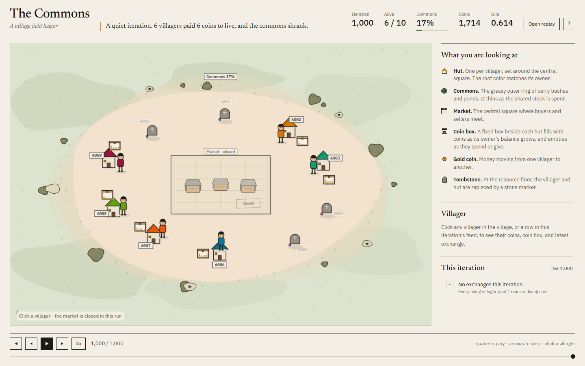

# The Money World



*A money-world run with gifting enabled, 1,000 iterations. Every villager has a
hut and a coin box around the central market square; the surrounding meadow
commons is a real renewable goods stock that thins when agents extract from it.
Open `simulation.html` to replay the whole run.*

An experimental agent-based simulation of resource sharing and inequality.
Agents have different generosity and acceptance tendencies. When
`GIFTING.ENABLED` is true, living agents may transfer a variable amount of
resources to another living agent, remember previous givers, and pay a cost of
living. Gifting is off by default; turning it on restores the original transfer
model. When the optional market is enabled, they also produce and consume
goods, and unmet demand adds an emergency money cost. An agent that reaches the
configured resource floor is dead and no longer participates.

This is the original money world. It shares configuration, metric, replay, and
experiment utilities with the subsistence world, but keeps its own rules,
configuration, replay schema, and viewer. Run it from the repository root with
`python main.py`; the implementation lives in `worlds/money/world.py` and the
root entry points are compatibility shims.

## Status

This is a small research-style simulation project. It is intended to make the
rules and measurements easy to inspect, not to model a real economy or make
economic predictions.

Supported Python versions: 3.11 through 3.14.

## Model

Each agent has:

- a money balance (`resources`);
- a resource floor below which the agent is dead;
- a generosity score, which controls the chance of giving;
- an acceptance score, which controls the chance of receiving;
- short-term memory of agents that previously transferred resources, plus
  optional private trust beliefs;
- an optional goods inventory; and
- a fixed risk tolerance.

The optional layers add a goods market, trust and reputation, reciprocity, and
environmental shocks. `MODEL.md` documents the combined rules and conservation
ledger.

Affordability is derived from the agent's resource balance. Agents below the
configured resource range become less likely to give, while acceptance is
weighted in the opposite direction. Transfer amounts are sampled from the
configured range and capped by the giving floor and receiving ceiling. A
transfer is made only when both agents are alive. After transfers, every
living agent pays the configured cost of living; reaching the resource floor
does not create a resource top-up.

The simulation records mean, median, standard deviation, total resources, and
the Gini coefficient after each iteration. Successful gifts, repayments, and
market trades also go into `transfer_log` and `trade_log`, which the visualizer
replays. The source of truth is a list of `Agent` objects; Pandas is used only
to expose the current state for analysis.

## Market (optional)

`config.yaml` has a `MARKET` section that is disabled by default. When
`MARKET.ENABLED` is true, living agents also produce and consume one good:

- each agent produces `PRODUCTION_RANGE` goods per iteration;
- each agent needs `CONSUMPTION_RANGE` goods per iteration;
- agents consume their own goods first and buy shortfalls from other agents'
  surplus at the current price;
- unmet demand is charged at `UNMET_DEMAND_PENALTY` money per unit, so a good is
  worth that much to a buyer and buyers refuse prices above it;
- buyers keep back the fixed living cost, and seller income respects the same
  receiving ceiling as gifts;
- a seller with `SELLER_RESERVATION_PRICE` above the market price holds goods
  instead of selling;
- a buyer with unmet demand can extract from the commons; extraction is limited
  by `EXTRACTION_LIMIT`, loses `1 - EXTRACTION_EFFICIENCY` as waste, and is
  preferred over buying only when the price is above `EXTRACTION_COST`;
- the price starts at `PRICE` and moves each iteration from the balance of
  unmet demand and unsold goods (`PRICE_ADJUSTMENT`, `MIN_PRICE`, `MAX_PRICE`);
- unsold goods stay in inventory.

Transfers, repayments, and market trades only move money between agents.
Production and commons regeneration create goods, consumption and extraction
waste destroy them, and subsistence payments move money to the commons fund.
`MODEL.md` documents the full ledger, and `tests/test_conservation.py` plus
`tests/test_market.py` enforce it.

## Money and the commons

Money is conserved. The four standard functions are represented:

- **medium of exchange** for gifts, repayments, and market trades;
- **unit of account** for prices, gifts, debts, and fines;
- **store of value** because funds are not deleted — they move to
  `commons_fund` and stay there until `FUND_REDISTRIBUTION` returns part of them
  as a dividend;
- **standard of deferred payment** because gift debts are fixed money amounts
  due after `REPAY_DELAY`, survive default, and can be settled later.

The commons is not a money mirror. It has a real goods stock that regenerates
each iteration and is depleted by extraction. Agents with money buy while the
market price is low; when the price exceeds `EXTRACTION_COST`, they forage from
the commons first. Extraction is less efficient than production or trade, so it
is a survival fallback rather than a free lunch.

## Altruism and reciprocity (optional)

Direct transfers are the altruism layer and are gated by
`GIFTING.ENABLED` (off by default). Set it to true to restore the original gift
model. Market trades are kept separate. Set `SOCIAL.RECIPROCITY_ENABLED: true`
to schedule a possible repayment after each gift. Each agent draws a hidden
`REPAY_PROBABILITY_RANGE` value, and
`REPAY_DELAY` and `REPAY_FRACTION` control the attempt. Unpaid debt is not
forgotten: it is charged `DEFAULT_PENALTY_RATE`, retried after
`REPAY_RETRY_DELAY`, and blocks new gifts from the creditor while
`EXCLUDE_DEFAULTERS` is true. `repayment_log` records who repaid whom and how
quickly, while metrics report `gift_volume`, `net_gift_volume`,
`reciprocity_rate` (value-based), `repayment_event_rate`, `outstanding_debt`,
`defaulted_debt`, and `written_off_debt`. `tests/test_social.py` covers the
rules.

## Environmental shocks (optional)

Set `SHOCKS.ENABLED: true` and list events in `SHOCKS.SCHEDULE` to apply
`scarcity` (reduced production) or `information` (noisy reputation) shocks for
a fixed `duration`. Living agents adapt their risk tolerance when demand is
unmet. Metrics include `shock_active`, `production_modifier`,
`reputation_noise`, `mean_risk_tolerance`, and `alive`; `recovery_time()`
reports how long unmet demand took to return to its pre-shock level.
`tests/test_shocks.py` covers the rules.

## Trust and reputation (optional)

Set `TRUST.ENABLED: true` to add private beliefs and public reputation. Every
agent starts at `INITIAL_BELIEF`. When a due gift is actually repaid or
defaulted, the creditor updates its belief about the debtor and a shared public
reputation observation, with configurable `LEARNING_RATE`, `DECAY`, `NOISE`,
`DELAY`, `BIAS`, and `PUBLIC_WEIGHT`. Gifts alone do not raise reputation. The
simulation reports `mean_trust`, `mean_reputation`, `reputation_error`, and
`reputation_brier`.

Set `TRUST.DECISION_WEIGHT` above 0 to use those beliefs when choosing a
receiver. Risk tolerance scales how far the agent acts on its belief versus the
prior; expected net payoff is `risk-adjusted belief * REPAY_FRACTION - 1`,
turned into a probability with a fixed `DECISION_TEMPERATURE`, then blended with
the legacy memory weight. Giving and accepting keep their affordability scores,
so trust is counted once instead of being multiplied through selection, giving,
and acceptance. `decision_log` records each attempt; `tests/test_trust.py` and
`tests/test_decisions.py` cover the update and decision rules.

## Experiments

`experiments.py` runs each seed and parameter combination, then writes raw runs
and a summary with 95% confidence intervals:

```bash
python experiments.py --iterations 500 --seeds 1 2 3 \
  --sweep SIMULATION.AGENTS=5,10 \
  --sweep MARKET.ENABLED=true \
  --output results/runs.csv
```

Sweep values are parsed as JSON when possible, so booleans, numbers, and lists
work (`SHOCKS.SCHEDULE='[{"iteration": 100, "type": "scarcity", "magnitude": 0.5}]'`).
The command writes `results/runs.csv`, `results/runs_summary.csv`, and
`results/runs_summary.json`. Use `--config` to start from a custom YAML file and
`--metrics` to choose which final metrics to aggregate.

## Replay export

The simulation can write a versioned, headless replay log instead of only an
HTML page. The log is the stable boundary between the model and any renderer:

```bash
python main.py --replay replay.json.gz --iterations 500
# or run the exporter directly
python replay.py --output replay.json.gz --iterations 500
```

`replay.py` writes compact JSON (gzip when the path ends in `.gz`) and validates
it on both write and load. A replay contains:

- `schema_version` and `meta`: the format version, actual iteration count, seed,
  config, and enabled feature flags;
- `agents`: stable ids, labels, colors, and initial traits;
- `ticks`: one entry per iteration, with per-agent resources, goods, alive
  status, risk tolerance, reputation, and summary metrics such as Gini,
  `total_money`, `commons_fund`, `commons_goods`, and the commons stock ratio;
- `events`: typed `gift`, `repayment`, `trade`, `death`, and `shock` records,
  each with a tick, phase, sequence number, and stable id.

Deaths are recorded explicitly with their cause (`gift`, `repayment`, `market`,
or `living_cost`) instead of being inferred from a resource crossing.
`living_cost_paid` records money moved into the commons fund, and
`total_money = total + commons_fund` is conserved, so the whole ledger can be
reconciled from the replay alone.

## Standalone viewer

`viewer/` is a playback client over the replay log. It contains no simulation
code and does not import the model. Serve the repository root, then open the
viewer with a replay path:

```bash
python -m http.server 8000
# http://localhost:8000/viewer/?replay=/replay.json.gz
```

The **Open** button also loads a local `.json` or `.json.gz` replay directly, so
the viewer works without a server. `visualize.py` still writes a single
`simulation.html` by inlining the same viewer assets and replay; the typefaces
load from Google Fonts and fall back to local serif/sans stacks offline.

To capture reproducible frames, use the Playwright script in `viewer/`:

```bash
cd viewer
npm install
npx playwright install chromium
node capture.mjs --replay ../replay.json.gz --out ../capture \
  --fps 30 --seconds 20 --video ../capture/commons.mp4
```

The script serves the viewer and replay locally, pauses playback, steps the
timeline at a fixed rate, and writes `frame-00000.png` onwards. Passing
`--video` invokes FFmpeg (which must be on your `PATH`) to turn the frames into
an MP4; frames are kept either way. Use `--canvas-only` to capture just the
canvas.

## Quick start

```bash
python -m venv .venv
# Windows
.venv\Scripts\activate
# macOS/Linux: source .venv/bin/activate

python -m pip install -r requirements.txt
python main.py --iterations 500
python visualize.py --iterations 500
python -m pytest -q
```

Both `main.py` and `visualize.py` support `--config <path>` to load a custom YAML
configuration file and `--iterations <n>` to override the run length.

`visualize.py` creates a self-contained `simulation.html` village view that
replays the recorded run. Open it in a browser; the replay starts automatically
(press **space** to pause). Every agent has a hut on a ring around the central
market square. All villagers are the same size; a fixed coin box beside each hut
fills with gold coins as its owner's balance grows and empties when they give,
spend, or pay the living cost, so wealth is visible without changing the body
size. A gold coin is drawn whenever money changes hands: gifts and repayments
happen at the receiver's hut, while market trades happen in the central square.
The outer meadow carries berry bushes and small ponds whose ripeness and water
level mirror the real commons goods stock. It thins when agents extract goods
and recovers as the commons regenerates; it is no longer a mirror of money.
Click a villager or a feed row to inspect them, and drag the timeline to scrub.
When everyone dies, the timeline trims at extinction.

The world is a presentation layer over the recorded events, not a change to
who can interact: it replays the existing model and leaves conservation
untouched. The view works with the optional layers: enable `MARKET`, `TRUST`,
`SOCIAL`, and `SHOCKS` in the configuration and their effects appear in the
village, inspector, and event feed. Pass `--plotly` to `visualize.py` to write
the original Plotly line chart instead.

The random seed and model parameters are defined in `config.yaml` and loaded
through `utils.load_config`. For interactive use, construct
`ResourceSimulation` with a copied and edited configuration, call `run()`, and
inspect `metrics_history` or the returned DataFrame.

## Project structure

- `config.yaml` - money-world simulation parameters.
- `world.py` - agents, simulation lifecycle, affordability, market, and metrics.
- `MODEL.md` - units, conservation ledger, and market rules.
- `../../utils/` - shared configuration, metric, replay, and experiment helpers.
- `../../main.py`, `../../replay.py`, `../../experiments.py`, and
  `../../visualize.py` - repository-root compatibility shims.
- `../../viewer/` - the money-world replay client and Playwright capture script.
- `../../tests/` - tests for both worlds and the shared utilities.
- `../../docs/` - README screenshots.

## Limitations

The model has no wages, births, or spatial network. The market uses a single
good with a single adaptive price, the commons has one renewable stock, shocks
follow a fixed schedule, and trust updates are simple heuristics rather than
estimated beliefs. Money is conserved, but agents can still run out of it
because payments accumulate in the commons fund. The default horizon stops
before that point and `extinction_iteration` makes the event explicit. Its
results depend on the chosen rules and random seed; treat it as an educational
simulation and a base for further experiments.
